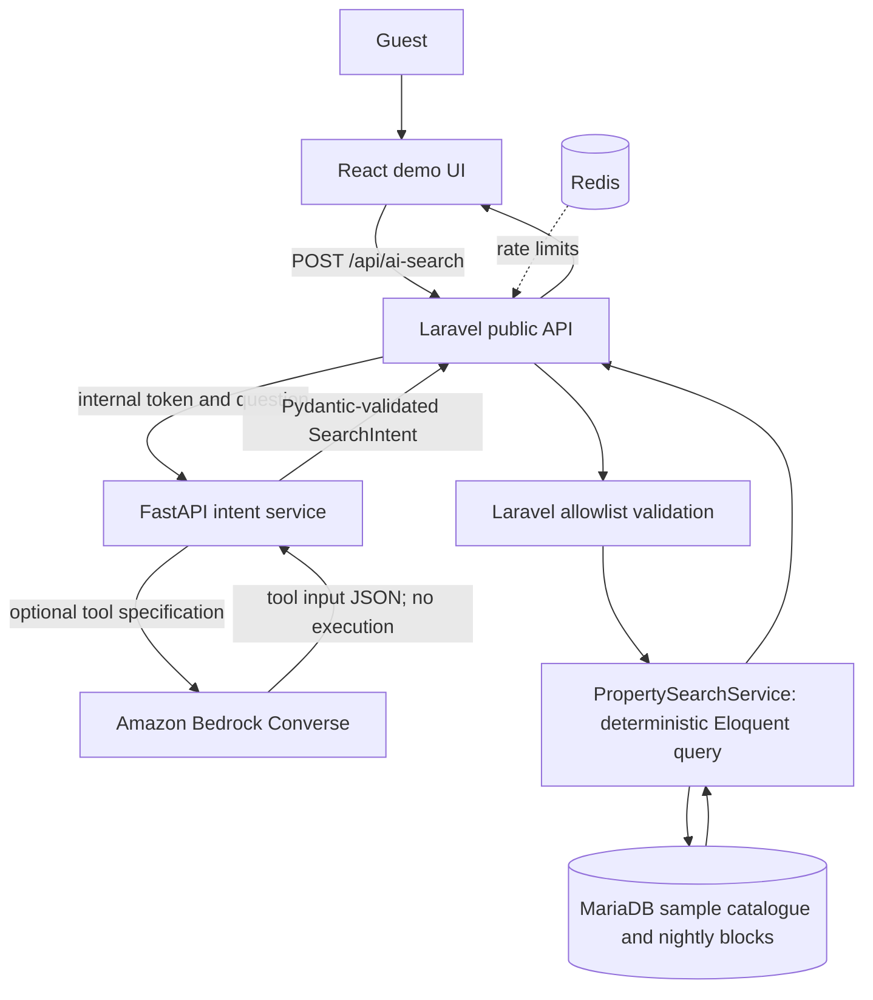
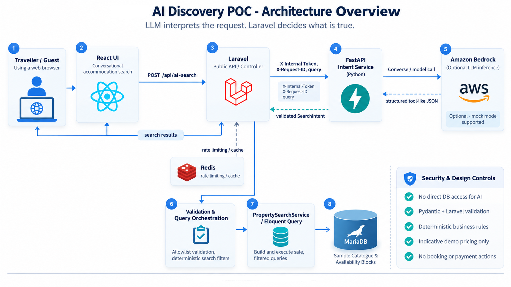
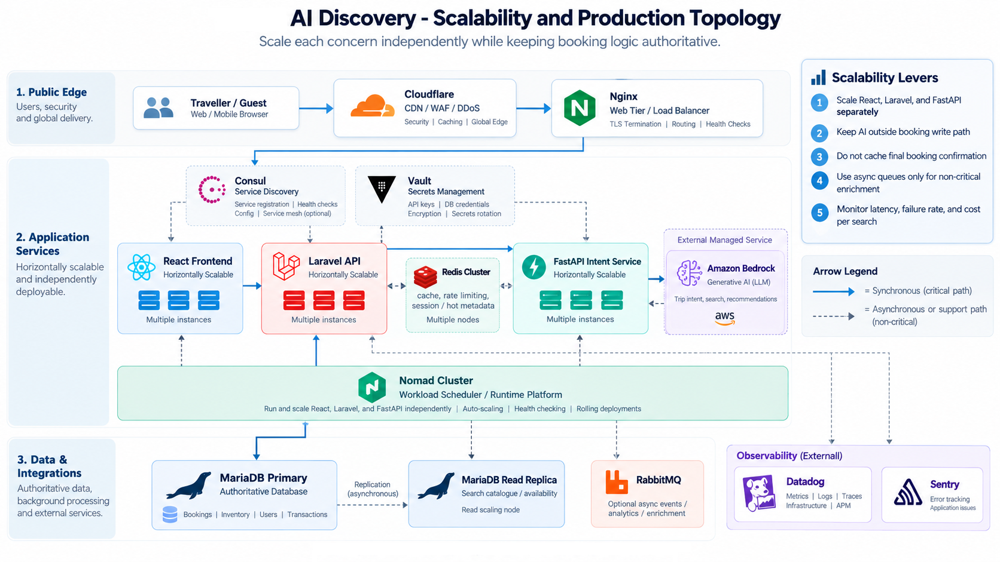

# Architecture and design decisions

**Status:** Unofficial demonstration proposal; not based on access to real systems, schema, workloads or infrastructure diagrams. The technology choices are informed by the supplied stack list, not verified implementation details.

## Core principle

> The LLM interprets a traveller's question. The business application decides what is true.

The design keeps existing Laravel application logic authoritative and introduces Python only at the natural-language boundary.





### Execution example

**User says:** `Pet-friendly beachfront in Hermanus for 4 guests under R2,000 a night with parking`.

**AI returns only:**

```json
{
  "destination": "Hermanus",
  "guests": 4,
  "max_price_zar": 2000,
  "amenities": ["beachfront", "parking"],
  "pets_allowed": true,
  "check_in": null,
  "check_out": null
}
```

**Laravel then constructs its own query:** `active=true AND city='Hermanus' AND capacity>=4 AND base_price<=2000 AND pet_allowed=true AND amenities includes ...`. This is implemented using Eloquent query builders and fixed predicate definitions. The model is not allowed to submit SQL, choose database tables, override tenant permissions, or trigger financial actions.

### Defined API boundary

- Frontend -> Laravel: `POST /api/ai-search`, JSON `{query: string}`.
- Laravel -> FastAPI: `POST /v1/interpret`, `X-Internal-Token`, `X-Request-ID`, `{query: string}`.
- FastAPI -> Laravel: `{mode: 'mock'|'bedrock', intent: SearchIntent}`.
- Laravel -> browser: searched results and interpreted fields; no raw model response.

## Responsible technology selection

| Layer | POC implementation | Why |
|---|---|---|
| React + Vite | Implemented | Easily embedded into an existing React frontend |
| Laravel 13 | Implemented overlay | Owns business rules; does not give AI direct DB access |
| PHP / MariaDB | Implemented | Familiar application and storage stack |
| Python / FastAPI | Implemented | Your existing strength; isolated LLM orchestration |
| Pydantic | Implemented | Strict and testable model response contract |
| AWS Bedrock | Optional, implemented client path; untested live | Model-neutralish `Converse` integration, controlled AWS IAM |
| Redis | Development runtime | Supports Laravel cache-backed request throttling |
| Docker Compose | Development definition | Reproducible local multi-service run; not a production deployment |
| RabbitMQ | Deliberately deferred | Useful for async enrichment/analytics but unnecessary for synchronous search |
| Nomad / Consul / Vault | Deployment proposal only | Align with indicated self-managed platform; no migration to Kubernetes required |
| Terraform | Later infrastructure phase | Provision secrets/IAM/observability only after confirming their existing standards |
| Datadog / Sentry | Production integration proposal | Track latency, errors and quality; not wired into demo |
| S3 / CloudFront | Existing-asset integration proposal | Not necessary to solve this narrow POC |

The full corporate stack should **not** be forced into a small demo. Technology is chosen only where its responsibility is justified.

## Boundaries and security controls

1. No production credentials, customer personal data, listings or booking records in this codebase.
2. Laravel validates the public input length and applies request rate limiting. Redis backs the Laravel cache when run through Compose.
3. FastAPI rejects unauthenticated internal requests; the shared token is for **local POC only**. Production should use service identity, private networking and managed secret rotation.
4. FastAPI's Pydantic model rejects extra or out-of-range fields, unknown amenities, and invalid date ranges.
5. Laravel **revalidates** the AI response. It uses parameterised Eloquent queries with explicitly enumerated filters.
6. No model-inferred dates when none are provided; no fabricated property names, nightly prices or availability.
7. The sample date exclusion only demonstrates a property-night block lookup. A true booking platform requires room/units inventory, reservations, channel-manager updates, timezones, payment and concurrency controls.
8. There is no booking or payment action, so model output cannot mutate financial or reservation state.
9. The model service returns a generic error when inference fails to avoid exposing provider or environment details.
10. Request IDs let traces be correlated across Laravel and the AI service. Full distributed tracing, metrics and structured logging are future work.
11. Production would need identity and tenant controls, CSRF strategy, rate-limit policy, network policy, data residency and POPIA review, secrets management, model guardrail tests, human-reviewed prompts and audit retention rules.
12. The frontend describes all prices as **indicative demo values**, rather than actual available offers.

## Product and infrastructure scaling

For production, don't expand the Python service to absorb existing pricing or bookings. Reuse Laravel domain services or existing internal APIs as trusted tools, enforced by the same authorisation logic as conventional user flows.

Suggested production topology, subject to discovery:



- Keep React and Laravel in existing web tier behind their current Nginx/Cloudflare/CloudFront setup.
- Deploy a separately scalable FastAPI service to existing Nomad workloads. Use Consul discovery; Vault for secrets if already adopted.
- Use an approved model hosted in an available AWS Bedrock region/account and verify cross-region privacy constraints.
- Cache only non-transactional metadata where safe. Do **not** cache a final booking availability confirmation.
- If needed later, use RabbitMQ for noncritical asynchronous search analytics, feature enrichment or insight jobs. Avoid adding it to the critical synchronous booking path.
- Use the existing Datadog and Sentry practices to record p50/p95 latency, model errors, cache effectiveness, fallback rates, valid-intent rate, cost per search and customer click-through.
- Introduce concurrency and cancellation safety at booking-confirmation time, separate from discovery.

## Cost and performance

**Mock mode:** No model inference charges, no AWS resources. Local CPU, RAM and image download costs only.

**Bedrock mode:** Inference can incur per-token charges, plus any inter-region networking/transfer or logging charges. Do not claim a particular rate before selecting a model/region and checking current pricing. Constrain input length, use `maxTokens=350`, apply rate limiting and establish per-user quotas before opening an LLM endpoint to the public internet.

Target SLOs need baseline data, not guesses. Define search volume, p95 latency and cost per 1,000 searches after measuring a workload. The POC has no real performance benchmark.

## Measurable product success

- Intent accuracy on an anonymised, manually labelled set of searches.
- Search-to-listing click-through versus conventional filters.
- Search-to-booking conversion in an A/B test (with real prices/availability checked separately).
- No fabricated listing, price or booking claims.
- Model inference cost per successful relevant result.
- Error and escalation rate, especially for unsupported dates and destinations.

## Most important next technical discovery questions

1. Is accommodation search already a dedicated service, or does it run inside the Laravel monolith?
2. How are property inventory and live prices sourced, updated and confirmed?
3. What are the search traffic, p95 latency and peak-day booking consistency constraints?
4. Which Nomad, Consul, Vault and AI-provider deployments are actually used today?
5. Is the priority conversion, host tooling, developer productivity or internal support?
